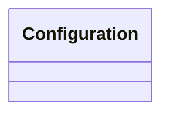

# configuration.proto

**Package: zaphiro.platform.v1**

<!-- markdownlint-disable --> 
Messages to distribute configuration to services.

> [!WARNING] 
> 
> These messages are only for internal use in the platform and are not intended to be used by external services.

## Imports

| Import                       | Description |
|------------------------------|-------------|
| google/protobuf/struct.proto |             |

## Options

| Name       | Value         | Description |
|------------|---------------|-------------|
| go_package | ./platform/v1 |             |

### zaphiro.platform.v1 Diagram

### Configuration Diagram

## Message: Configuration

**FQN**: zaphiro.platform.v1.Configuration

A configuration snapshot distributed to platform services.
* Headers used in RabbitMQ:
* `id` (string): id of the `Configuration` message (a random uuid).
* `producerId` (string): the id of the producer of the message.
* `timestampId` (int64): the creation Unix msec timestamp.

| Field | Ordinal | Type | Label | Description |
|-------|---------|------|-------|-------------|

<!-- Created by: Proto Diagram Tool -->
<!-- https://github.com/GoogleCloudPlatform/proto-gen-md-diagrams -->
